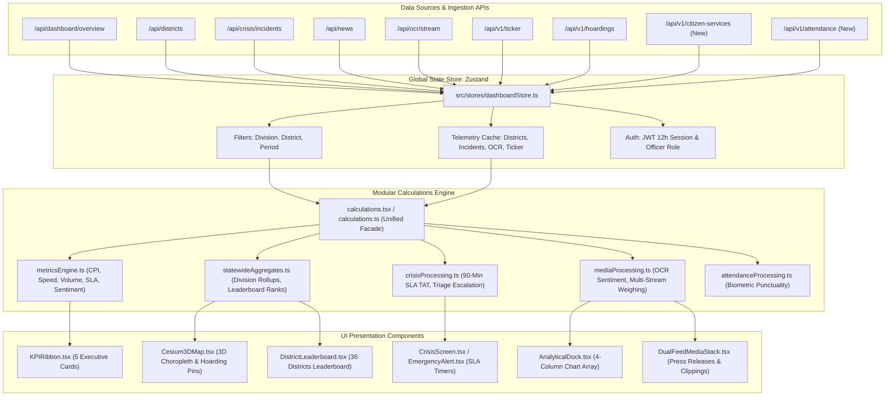

# DGIPR Maha-Command Center: Component Architecture & Dependency Tree

This document outlines the complete component hierarchy, data flow pathways, and state dependencies of the Maha-Command Center (MCC) frontend.

---

## 1. High-Level System Architecture Tree

```text
src/app/layout.tsx (Root Layout)
│
├── src/components/auth/AuthGate.tsx (Session Boundary & Route Gate)
│   ├── [Unauthenticated / Loading] ➔ src/components/auth/FullScreenAuthLoader.tsx
│   ├── [Login Route] ➔ src/app/login/page.tsx ➔ src/components/portal/LoginScreen.tsx
│   └── [Authenticated Session] ➔ src/components/layout/DashboardLayout.tsx
│       │
│       ├── src/components/layout/Header.tsx (Global Telemetry Bar & Context)
│       │   ├── src/components/shared/GovEmblem.tsx (Maharashtra State Seal)
│       │   ├── src/components/layout/GlobalSearchBar.tsx (Command Search)
│       │   ├── [Live Duty Clock] (IST Tabular-Nums)
│       │   ├── [Language Switcher] (English / मराठी)
│       │   └── [Officer Profile & Tier Role Badge]
│       │
│       ├── src/components/layout/Sidebar.tsx (Nav Rail: Collapsible 220px ➔ 64px)
│       │   ├── [Top Executive Brand Anchor]
│       │   ├── [Primary Portals Group]: Newspaper, Live News, Ads, Hoardings, Fact-Check
│       │   ├── [Command & GIS Group]: Command Centre, 36 Districts, Biometric Attendance
│       │   └── [Operations & Admin Group]: Crisis Desk, Reports, System Monitoring, Settings
│       │
│       ├── src/components/ai/ai-assistant-widget.tsx (Route-Aware AI Copilot FAB)
│       │   └── src/components/copilot/CopilotDrawer.tsx (Slide-over Copilot Chat)
│       │
│       ├── src/components/shared/GlossaryDrawer.tsx (Government Acronyms Drawer)
│       │
│       └── MAIN WORKSPACE ROUTE OUTLET
│           ├── / (Home) ➔ src/app/page.tsx
│           │   ├── [Primary Active View] ➔ src/components/dashboard/ThreeColumnDashboard.tsx
│           │   └── [Backup Historical View] ➔ src/components/dashboard/MainDashboard.tsx
│           │
│           ├── /districts ➔ src/components/portal/DistrictsScreen.tsx
│           ├── /crisis ➔ src/components/portal/CrisisScreen.tsx
│           ├── /newspaper ➔ src/components/portal/NewspaperScreen.tsx
│           ├── /live-news ➔ src/components/portal/LiveNewsScreen.tsx
│           ├── /advertisements ➔ src/components/portal/AdvertisementsScreen.tsx
│           ├── /attendance ➔ src/components/portal/AttendanceScreen.tsx
│           ├── /publications ➔ src/components/portal/PublicationsScreen.tsx
│           ├── /fact-check ➔ src/components/portal/FactCheckScreen.tsx
│           ├── /command-center ➔ src/components/commandCenter/CommandCenterView.tsx
│           └── /system-monitoring ➔ src/components/commandCenter/TelemetryOperationsView.tsx
```

---

## 2. Main Executive Dashboard Tree (`ThreeColumnDashboard.tsx`)

```text
src/components/dashboard/ThreeColumnDashboard.tsx (Executive War Room Viewport)
│
├── TIER 1: GLOBAL CONTEXT & MODULE TABS (Header Strip)
│   ├── [Status Pill]: DGIPR Command Center • Supervision: DG Desk
│   ├── [Division Dropdown]: All / Konkan / Pune / Nashik / Marathwada / Amravati / Nagpur
│   ├── [District Dropdown]: All 36 Districts (#1 to #36)
│   ├── [Timeframe Selector]: Last 24 Hours / 7 Days / 30 Days
│   ├── [Export Action Button]: PDF / Excel Ingestion Dump
│   └── [Module Tab Switcher]:
│       ├── "overview" ➔ GIS Map & Command (Default)
│       ├── "performance" ➔ District Performance
│       ├── "media" ➔ Media & Broadcast
│       ├── "crisis" ➔ Crisis Desk
│       ├── "hoardings" ➔ Outdoor Hoardings
│       └── "all" ➔ Command Wall (All)
│
├── TIER 2: BREAKING NEWS WIRE TICKER
│   └── src/components/dashboard/BreakingNewsTicker.tsx (Real-Time Ingestion Stream)
│
├── TIER 3: 5-COLUMN CORE KPI RIBBON
│   └── src/components/zones/KPIRibbon/KPIRibbon.tsx
│       ├── [Card 1]: Press Releases (Actual vs. Target 300)
│       ├── [Card 2]: Media Placements (Verified Clippings & Multi-Channel Volume)
│       ├── [Card 3]: Net Sentiment Index (Print 35%, TV 25%, Social 25%, Comments 15%)
│       ├── [Card 4]: Crisis SLA / TAT (90-Min Resolution Rate & Active Incidents)
│       └── [Card 5]: Field Events (Ministerial Engagements & Dispatch Timeliness)
│
└── TIER 4: VIEWPORT MODULE CONTAINERS (Driven by activeView)
    │
    ├── [VIEW: overview] ➔ GIS Map & Command (Bento Layout)
    │   ├── LEFT MAIN STAGE (8 Columns):
    │   │   └── src/components/cesium/Cesium3DMap.tsx (3D Extruded Choropleth Hero)
    │   │       ├── [Compass Control]: Apple Maps Gyroscopic Heading Indicator
    │   │       ├── [Layer Switcher Pills]: CPI / Coverage / Sentiment / Crisis / Events
    │   │       ├── [Rendering Mode Pill]: Base Terrain + Dynamic Highlights vs. Full Heatmap
    │   │       ├── [Regional Dock]: Statewide All 36 / Konkan / Pune / Nashik / Marathwada / Vidarbha
    │   │       ├── [2D View Checkbox]: Clickable Apple Glass Checkbox (Flatten Extrusions ➔ Top-down)
    │   │       └── [District Inspection Card]: Live Rank, CPI Gauge, Releases, Net Sentiment
    │   │
    │   ├── RIGHT MEDIA STACK (4 Columns):
    │   │   └── src/components/dashboard/DualFeedMediaStack.tsx
    │   │       ├── [Tab 1: Press Releases]: Recent Government Press Releases with Timestamp
    │   │       └── [Tab 2: Media Clippings]: High-Priority Clippings with Publication Thumbnails
    │   │
    │   ├── BOTTOM ANALYTICAL DOCK (4 Equal Analytical Columns):
    │   │   └── src/components/dashboard/AnalyticalDock.tsx
    │   │       ├── [Col 1]: District Rankings Bar Chart (Top 5 & Lowest 5)
    │   │       ├── [Col 2]: Sentiment Divergence Stacked Stream (Print, TV, Social)
    │   │       ├── [Col 3]: Crisis SLA Compliance Donut Chart (Within 90m, In Triage, Breached)
    │   │       └── [Col 4]: Social Media Engagement Multi-Platform Graph (X, Meta, YouTube)
    │   │
    │   └── [Tactical Workspace Drawer / 3-Column Fallback Mode]:
    │       ├── Col 1: src/components/zones/EmergencyAlert/EmergencyAlert.tsx
    │       ├── Col 1: src/components/dashboard/CitizenServicesCard.tsx
    │       ├── Col 2: src/components/leadership/GISMap/GISMap.tsx
    │       └── Col 3: src/components/leadership/SocialMediaAnalysis/SocialMediaAnalysis.tsx
    │
    ├── [VIEW: performance] ➔ District Performance & Scorecards
    │   ├── Left (5 cols): src/components/zones/DistrictLeaderboard/DistrictLeaderboard.tsx
    │   ├── Left (5 cols): src/components/leadership/TopLowerMatrix/TopLowerMatrix.tsx
    │   ├── Right (7 cols): src/components/dashboard/DistrictScorecardBento.tsx
    │   ├── Right (7 cols): src/components/zones/ScoreDecomposition/ScoreDecomposition.tsx
    │   └── Right (7 cols): src/components/dashboard/KeyMetricsTrends.tsx
    │
    ├── [VIEW: media] ➔ Media Intelligence & Broadcast Hub
    │   ├── Left (7 cols): src/components/leadership/LiveStreaming/LiveStreaming.tsx
    │   ├── Right (5 cols): src/components/leadership/SocialMediaAnalysis/SocialMediaAnalysis.tsx
    │   └── Right (5 cols): src/components/dashboard/LiveNewsQueue.tsx
    │
    ├── [VIEW: crisis] ➔ Crisis Desk & SLA Command
    │   ├── src/components/zones/EmergencyAlert/EmergencyAlert.tsx
    │   └── src/components/portal/CrisisScreen.tsx
    │
    └── [VIEW: hoardings] ➔ Outdoor Hoardings & Field IEC
        ├── src/components/cesium/Cesium3DMap.tsx (3D Hoardings Billboard Pins Mode)
        └── src/components/dashboard/GovernmentSchemeHoardingsPanel.tsx
```

---

## 3. Data Pipeline & State Ingestion Flow



---

## 4. Reusable Shared & Primitive Components

```text
src/components/shared/
├── GovEmblem.tsx (Vectorized State Emblem of Maharashtra)
├── InfoTooltip.tsx (Universal "i" definition & formula popover)
├── MinimalCardHeader.tsx (Unified card title, status badge & action strip)
├── MetricTip.tsx (Radix Tooltip wrapper for metric definitions)
├── TermInfo.tsx (Inline dotted term glossary popover)
├── ScoreBadge.tsx (Standardized score pill badge: Green, Amber, Red)
├── MaterialIcon.tsx (Bilingual icon abstraction layer)
├── OutboundLink.tsx (Security-hardened external link with allowlist verification)
├── SampleDataBadge.tsx (Standardized amber badge for simulated data points)
└── Skeleton.tsx (Primitive layout shimmer loading element)
```

---

## 5. Decommissioned / Orphaned Components Inventory

```text
src/components/dashboard/
├── [KEEP AS BACKUP] MainDashboard.tsx ➔ Retained exclusively for older layout fallback
├── [DECOMMISSION] CrisisOperationsColumn.tsx ➔ Replaced by CrisisDesk & EmergencyAlert
├── [DECOMMISSION] DistrictOperationsColumn.tsx ➔ Replaced by DistrictScorecardBento
├── [DECOMMISSION] EurekaDraggableDeck.tsx ➔ Replaced by Bento Grid Layout
├── [DECOMMISSION] ExecutiveIntelligenceSummary.tsx ➔ Replaced by KPIRibbon
├── [DECOMMISSION] LiveNewsTicker.tsx ➔ Replaced by BreakingNewsTicker
├── [DECOMMISSION] MaharashtraGISDeck.tsx ➔ Replaced by Cesium3DMap
├── [DECOMMISSION] OperationalAnalyticsDeck.tsx ➔ Replaced by AnalyticalDock
├── [DECOMMISSION] OperationsWorkspace.tsx ➔ Replaced by ThreeColumnDashboard
└── [DECOMMISSION] SocialSentimentPulse.tsx ➔ Replaced by SocialMediaAnalysis
```
